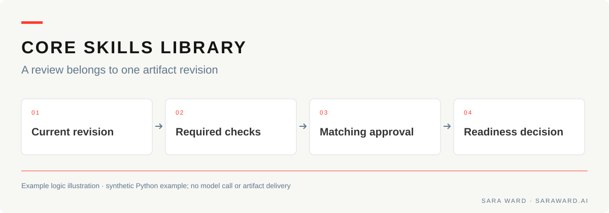

# Core Skills Library



Reusable agent instructions with client configuration kept separate, so a change for one deployment does not get mixed into the general operating logic.

[Architecture](docs/architecture.md) · [Python example](examples/approval_gate.py) · [Tests](tests/test_approval_gate.py) · [CI checks](https://github.com/saraaward/core-skills-showcase/actions)

## At a glance

- **For:** teams organizing reusable agent instructions and keeping client configuration separate from shared operating logic.
- **My contribution:** architecture, authoring standards, ownership boundaries, and versioning approach.
- **What this demonstrates:** designing explicit review boundaries and documenting what an executable example does and does not establish.
- **Evidence:** [architecture](docs/architecture.md), [runnable Python example](examples/approval_gate.py), [regression tests](tests/test_approval_gate.py), and [CI runs](https://github.com/saraaward/core-skills-showcase/actions).

**Status:** a private architecture foundation with a public synthetic approval example. The example returns a readiness decision; it does not call a model, authenticate reviewers, or deliver an artifact.

## What I built

The private library contains skill-authoring standards, personal-context retrieval guidance, templates, and versioning rules. One canonical skills directory supports discovery by Claude Code and Codex.

The architecture defines separate homes for judgment, mechanical scripts, platform adapters, workflow coordination, client configuration, and evaluations. The [architecture guide](docs/architecture.md) explains those boundaries and the implementation status.

**My role:** system owner and principal designer of the architecture, authoring standards, ownership boundaries, and versioning approach.

## Try the public example

The standalone Python approval gate makes one decision: is this artifact revision ready?

It checks required results, verifies that evaluation belongs to the current revision, and requires approval of that same revision. Failed checks block readiness; ambiguous evaluation or missing approval requires review.

```bash
python3 examples/approval_gate.py
python3 -m unittest discover -s tests -v
```

**Python 3.9+ · Standard library only · 10 regression tests · GitHub Actions**

This synthetic example returns a decision. It does not call a model or deliver an artifact. [Implementation limits](docs/architecture.md#example-boundary) explain the trusted state a real application would need.

[Portfolio](https://saraward.ai)
